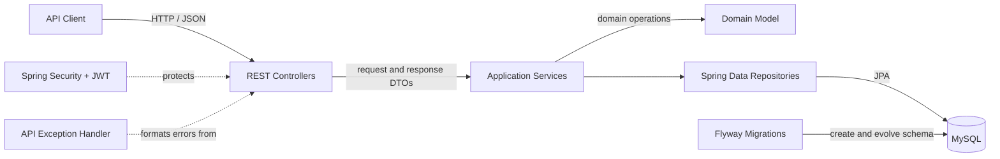
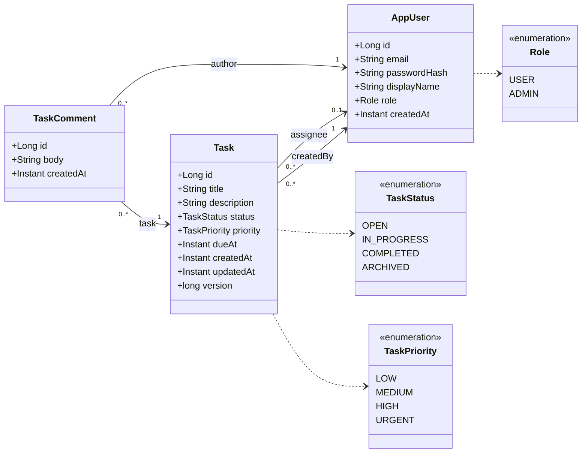
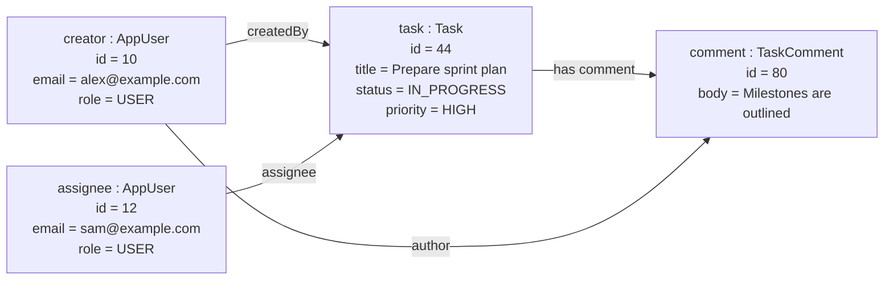
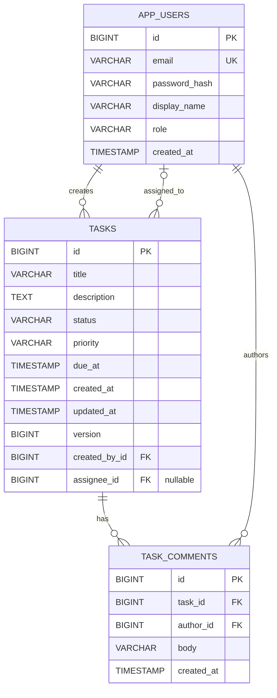
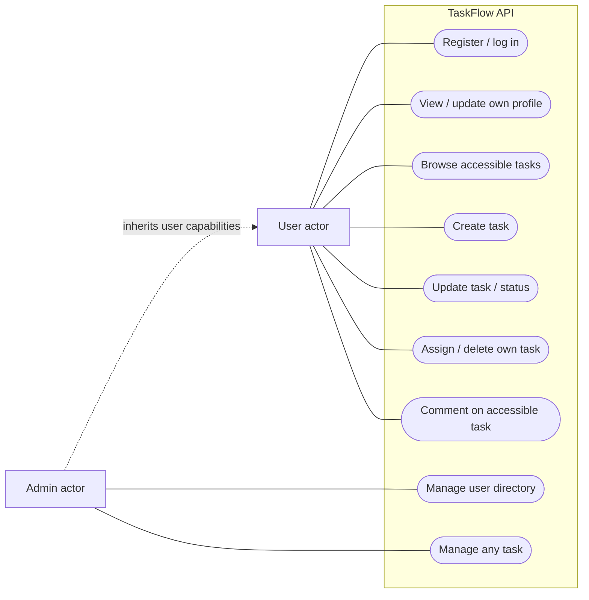
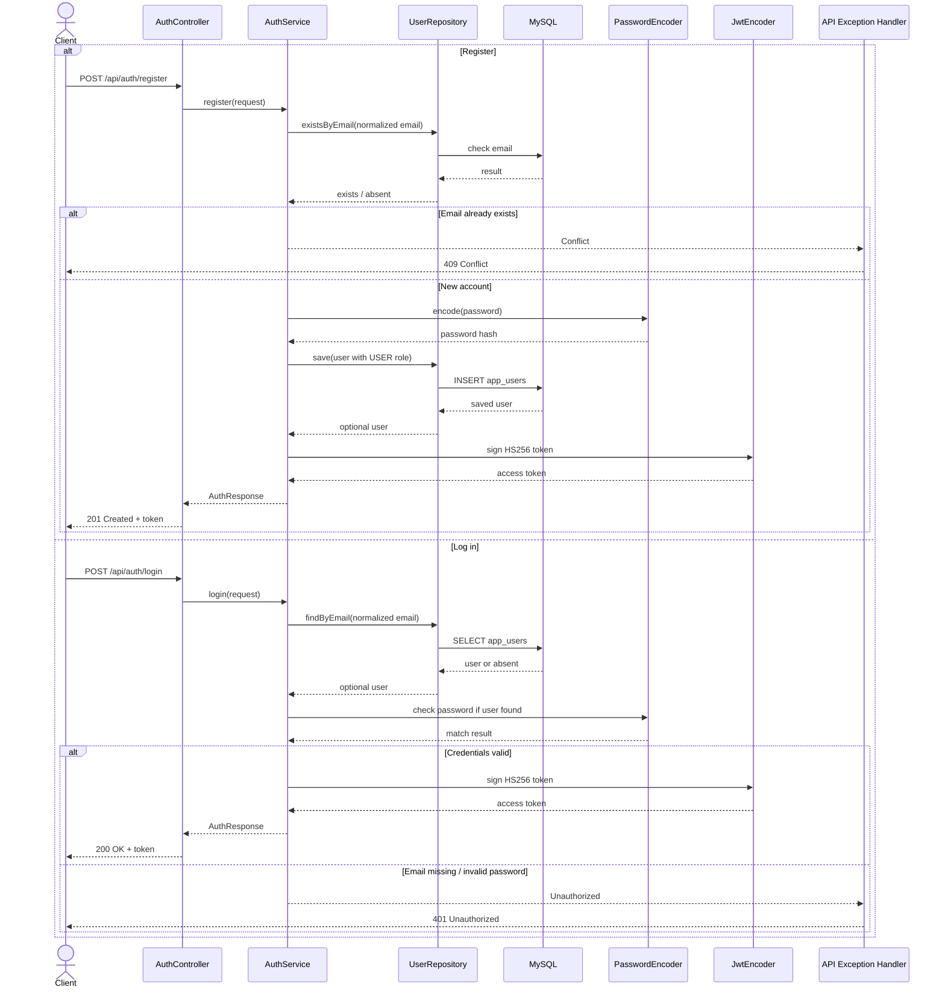
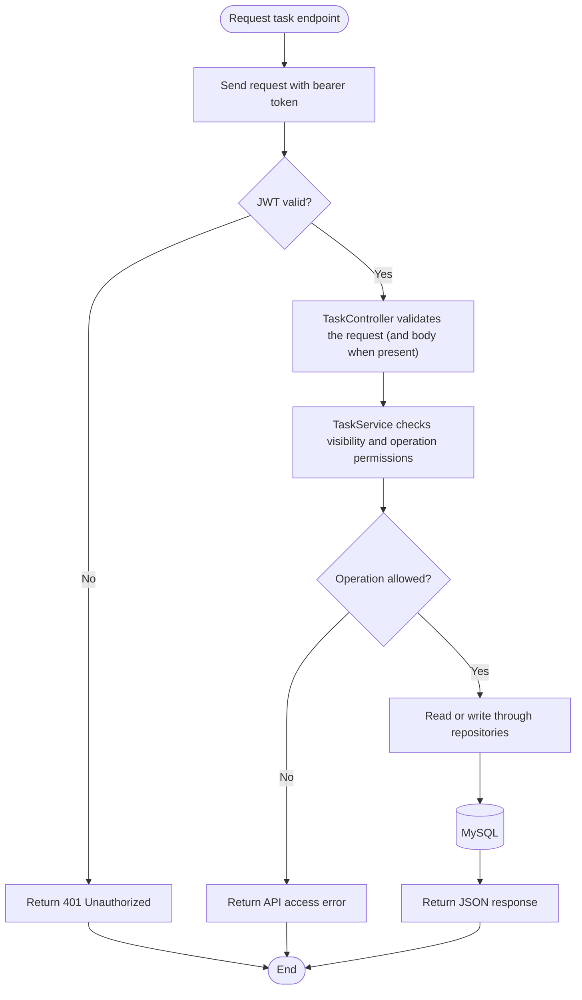

# TaskFlow UML

UML documentation for the [TaskFlow API](https://github.com/Utkarsh-tiwari-1/taskflow-api), a Spring Boot task-management REST API.

GitHub renders the Mermaid previews below. Editable PlantUML sources are included for each view.

| Diagram | PlantUML source |
|---|---|
| [Architecture](#architecture) | [TaskFlow-Architecture.puml](TaskFlow-Architecture.puml) |
| [Class diagram](#domain-class-diagram) | [TaskFlow-Domain.puml](TaskFlow-Domain.puml) |
| [Object diagram](#object-diagram) | [TaskFlow-Object-Diagram.puml](TaskFlow-Object-Diagram.puml) |
| [Database ER diagram](#database-er-diagram) | [TaskFlow-ERD.puml](TaskFlow-ERD.puml) |
| [Use case diagram](#use-case-diagram) | [TaskFlow-Use-Cases.puml](TaskFlow-Use-Cases.puml) |
| [Authentication sequence](#authentication-sequence) | [TaskFlow-Authentication-Sequence.puml](TaskFlow-Authentication-Sequence.puml) |
| [Activity diagram](#task-request-activity) | [TaskFlow-Task-Request-Activity.puml](TaskFlow-Task-Request-Activity.puml) |

## Architecture

## Domain class diagram

A task has exactly one creator and may have one assignee. Each comment belongs to one task and has one author. The enum values and relationships match the JPA entities and the initial Flyway migration in the API project.

## Object diagram

This sample object snapshot shows a user creating a task, another user assigned to it, and a comment authored by the creator.

## Database ER diagram

`created_by_id`, `task_id`, and `author_id` are required foreign keys. `assignee_id` is nullable. Deleting a task cascades to its comments.

## Use case diagram

Task edits require creator, assignee, or admin access. Assignment and deletion require the creator or an admin. Admins can manage the user directory and all tasks.

## Authentication sequence

## Task request activity

Task routes require a valid bearer token. The service applies task visibility and creator, assignee, or admin rules before performing protected operations. Repository reads and writes depend on the selected endpoint.
