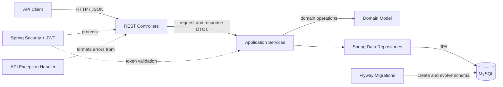
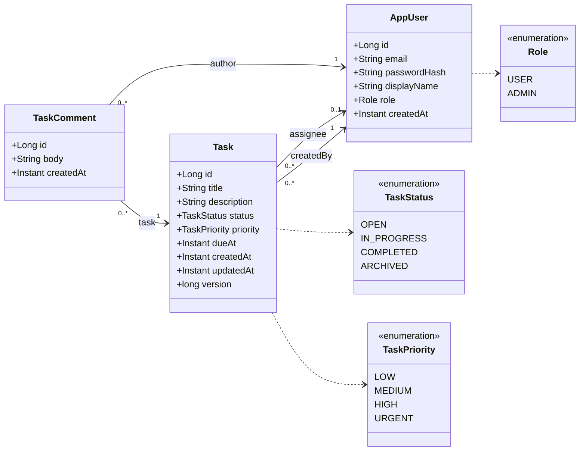

# TaskFlow UML

UML documentation for the [TaskFlow API](https://github.com/Utkarsh-tiwari-1/taskflow-api), a Spring Boot task-management REST API.

The diagrams below describe the current application layers and core JPA domain model. GitHub renders the Mermaid diagrams in this README. Editable PlantUML sources are in [`TaskFlow-Architecture.puml`](TaskFlow-Architecture.puml) and [`TaskFlow-Domain.puml`](TaskFlow-Domain.puml).

## Architecture

## Domain class diagram

A task has exactly one creator and may have one assignee. Each comment belongs to one task and has one author. The enum values and relationships match the JPA entities and the initial Flyway migration in the API project.
